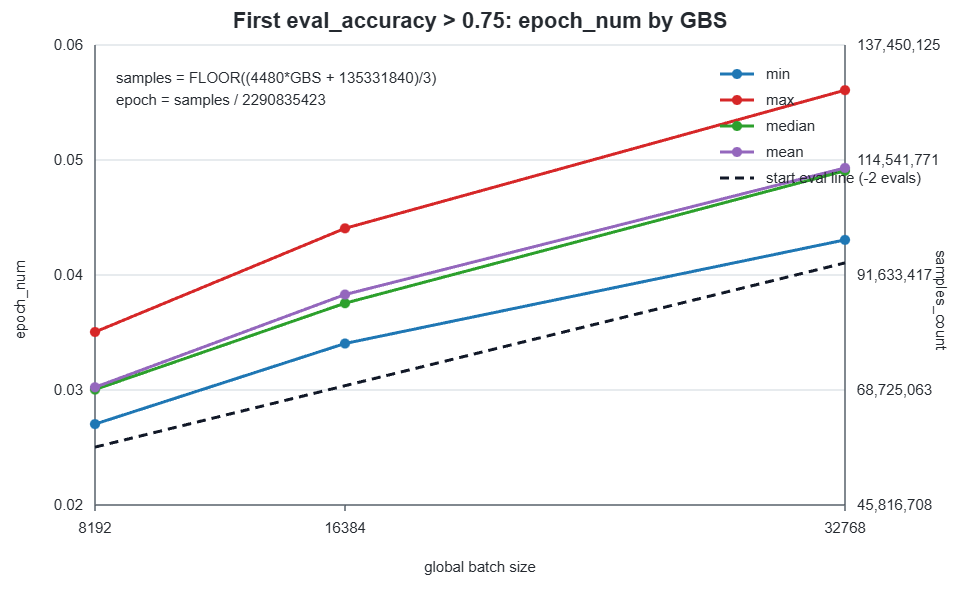

# DLRMv4 benchmark reference

What the MLPerf Training `dlrmv4` benchmark trains and how it is scored: the
dataset, the data order, the model and the quality target. To run it, see the
[DLRMv4 guide](README.md).

## Problem

The model predicts what a person will listen to next. It reads a user's
history of played, liked and skipped songs and ranks how likely the user is to
really listen to a candidate song (play at least 50% of it) instead of skipping
it.

It is a **sequential recommender**. A classic click-through-rate model such as
DLRM-DCNv2 scores each interaction on its own. HSTU instead reads the user's
chronologically ordered interaction history as a sequence, through a
Transformer-style attention stack. Each training example is one listen event
(the *anchor*), the user's history before it (*UIH*, user interaction history)
and a set of contextual and cross features. The label is binary: `listen_plus`
(played at least 50%) versus a skip.

Training follows time. The timeline is cut into daily windows. The model
trains on windows 0–298 in order and is evaluated on window 299, the day after
the last training window. Every metric therefore measures prediction of the
future. The quality metric is **AUC** on that held-out day, and the target is
**AUC ≥ 0.75**.

## Dataset

[Yambda-5b](https://huggingface.co/datasets/yandex/yambda) is a public,
anonymized music-recommendation dataset from Yandex Music
([arXiv:2505.22238](https://arxiv.org/abs/2505.22238)), distributed under the
terms of its HuggingFace repository.

| After preprocessing | |
|---|---|
| Interaction events | 4.76 B (train: 300 days, 4.76 B; test: 1 day, 22.4 M) |
| Users | 1.00 M (median 2,695 events, max 27,738) |
| Item catalog | 9.39 M |

| Event pool | Definition | Share |
|---|---|---|
| listen_plus (lp) | listened, played ≥ 50% | 61.3% |
| skip | listened, played < 50% | 35.9% |
| like | explicit like | 1.9% |
| other | dislike / unlike / undislike | 1.0% |

### Getting the data

There are two routes, and both end in the same files:

```
$DLRM_DATA_PATH/                                   A: download   B: build
├── processed_5b/
│   ├── hstu_cache_L4086/            227.24 GB     yes           built on the 1st training run
│   ├── item_popularity.npy              75 MB     yes           preprocessing
│   ├── train_sessions.parquet        46.79 GB     -             preprocessing
│   ├── session_index.parquet           600 MB     -             preprocessing
│   ├── test_events.parquet             152 MB     -             preprocessing
│   └── split_meta.json                  361 B     -             preprocessing
└── shared_metadata/
    ├── album_item_mapping.parquet     54.5 MB     yes           download
    └── artist_item_mapping.parquet    38.3 MB     yes           download
```

The trainer reads only `hstu_cache_L4086/` and the two mappings.
`item_popularity.npy` is used to cross-check the vocabulary size.

**A: download the prepared dataset** (227.41 GB, recommended). It comes from the
[MLCommons training data page](https://training.mlcommons-storage.org/index.html#dlrm-v4-benchmark);
the command is in the [guide's quick start](README.md#quick-start). The
downloader checks each file's md5, and `examples/mlperf/dlrm_v4/data/verify_dataset.sh`
checks the cache against
[`sha256sums_yambda_5b_cache.txt`](../../../../examples/mlperf/dlrm_v4/data/sha256sums_yambda_5b_cache.txt)
and the other files against
[`md5sums_yambda_5b_processed.txt`](../../../../examples/mlperf/dlrm_v4/data/md5sums_yambda_5b_processed.txt).

**B: build it from the HuggingFace release.** This takes about 53 minutes for
download and preprocessing, about 313 GB of disk at the peak (about 275 GB after
deleting `raw/`), and a host with about 190 GB of RAM for the cache build. Run it
in the `rocm/primus:v26.9` image with `polars-u64-idx` installed
(`pip install --no-deps polars-u64-idx==1.33.1`; the install hook does this at a
container's first training launch). Stock `polars` silently overflows its 32-bit
row index on Yambda-5b.

```bash
DLRM_DATA_PATH=/data/mlperf_dlrm_v4 examples/mlperf/dlrm_v4/data/download_dataset.sh   # download + preprocess
DLRM_DATA_PATH=/data/mlperf_dlrm_v4 examples/mlperf/dlrm_v4/data/verify_dataset.sh     # verify
```

The script downloads 38.3 GB from `yandex/yambda` (`flat/5b/multi_event.parquet`
and the two mappings), then runs `generative_recommenders.dlrm_v4.preprocess_public_data`:

1. Encode the event type (listen, like, dislike, unlike, undislike).
2. Split the events in time: 300 training days, a 30-minute gap, 1 test day (the
   dataset's Global Temporal Split).
3. Cut each user's timeline into sessions at 30 minutes of inactivity.
4. Count item popularity.

The first training run builds `hstu_cache_L4086/` from `train_sessions.parquet`.
The build is deterministic, so a locally built cache matches the same sha256
sums as the download: run `verify_dataset.sh` again afterwards.

### Window index

The data loader finds each window's anchors through an index
(`ts_indices_*.npy`, `ts_offsets_*.npy`, about 18 GB) in the cache directory. The
first run builds it if it is missing. On a read-only data mount, build it
beforehand:

```bash
python3 tools/recommendation/dlrm_v4/ts_index_tool.py prebuild \
    --cache-dir "$DLRM_DATA_PATH/processed_5b/hstu_cache_L4086" --history-length 4086
```

`ts_index_tool.py` can also `verify`, report `status`, and `check-staged` copies.
`DL_WINDOW_INDEX=0` scans the full cache per window instead (slow).

### Features

For each anchor (a listen event with at least `min_history` = 4086 earlier
events), the loader builds:

```
UIH (user interaction history)
  sequence, chronologically interleaved from 3 pools:
    item_id, artist_id, album_id, action_weight (lp / like / skip bits),
    action_timestamp, watch time
  contextual (1 entry each): uid + 7 cross-feature hashes
    (user_x_artist, item_x_hour, ...)

Candidate (the anchor listen event)
  item_id, artist_id, album_id, query time,
  action_weight (lp bit if listen_plus, else 0)  <- the label
```

From the last 20,000 events before the anchor, the loader takes the most recent
`4086 // 3 = 1362` events of each pool (lp, like, skip) and sorts them back into
time order. With 8 contextual entries and the candidate this fills
`3 × 1362 + 8 + 1 = 4095 ≤ 4096` positions. The rare `like` pool under-fills
(about 105 events per anchor); the attention kernels skip empty positions.

## Data order

**Windows.** A window is the set of anchors whose timestamp falls in one day
(86,400 s); windows are numbered from 0 in time order.

**Training order.** The run trains on windows 0–298 (`START_TS=0`,
`NUM_TRAIN_TS=299`) in time order, never shuffled. Within a window, anchors are
read in dataset order. `STREAMING_SHUFFLE_FRACTION` (default 0) can shuffle
inside a window without crossing window boundaries.

**Eval set.** Every eval scores the same fixed set: all anchors of window 299
(`EVAL_HOLDOUT_TS=299`), 2,058,204 samples, with no subsampling. Training never
reaches that window, and within an anchor, history is gathered only from events
strictly before it, so no future event leaks into training or into features.
Each eval scores the whole set, so the order does not affect the AUC.

## Model

**HSTU** (Hierarchical Sequential Transduction Units), from *Actions Speak
Louder than Words: Trillion-Parameter Sequential Transducers for Generative
Recommendations* (ICML'24, [arXiv:2402.17152](https://arxiv.org/abs/2402.17152)).
The code is derived from
[meta-recsys/generative-recommenders](https://github.com/meta-recsys/generative-recommenders);
the configuration is in `generative_recommenders/dlrm_v4/configs.py`.

**1. Embeddings.** TorchRec `EmbeddingCollection`, sharded across GPUs. Every
table has dimension 512 and is stored in FP32:

| Table | Rows | Table | Rows |
|---|---|---|---|
| `item_id` | 9,390,624 | `user_x_album` | 40,000,000 |
| `artist_id` | 1,293,395 | `user_x_hour` | 24,000,000 |
| `album_id` | 3,367,692 | `item_x_hour` | 40,000,000 |
| `uid` | 1,000,001 | `artist_x_hour` | 32,000,000 |
| `user_x_artist` | 100,000,000 | `user_x_is_organic` | 2,000,000 |
| | | `user_x_artist_x_hour` | 40,000,000 |

**2. User path (`HSTUTransducer`)**, over the history plus the candidate:

- A contextual preprocessor: linear layers over the 8 contextual entries, a
  content MLP, and an action encoder over the action bits, summed (512 wide).
- Position (8192 buckets) and time (2048 buckets) embeddings; input dropout 0.2.
- **3 STU layers** (`HSTU_NUM_LAYERS`): width 512, 4 heads, Q/K and U/V
  dimension 128 per head, causal target-aware attention. HSTU fuses attention
  and the feed-forward block into one UVQK projection with SiLU gating, so
  there is no separate FFN. Linear dropout 0.1.
- A postprocessor: cyclical time features (hour of day, day of week), then
  `Linear(516 → 512) → LayerNorm`.

**3. Item path:** the candidate's item, artist and album embeddings
concatenated (1536), then
`Linear(1536 → 512) → SwishLayerNorm → Linear(512 → 512) → LayerNorm`.

**4. Head:** the element-wise product of the user and item vectors, then
`Linear(512 → 512) → SwishLayerNorm → Linear(512 → 1)`: one logit for
`listen_plus`.

### Initialization

- Embedding tables: uniform in `±1/sqrt(rows)`. Each table's generator is seeded
  from `sha256(seed:table_name)`, so a seed gives the same tables on every rank
  and run.
- Dense layers: Xavier-uniform weights and zero biases. Inside the STU layers,
  the UVQK and output weights are Xavier-uniform and the norms start at one.
- Action embeddings: normal with std 0.1.
- Dense initialization is identical on every rank. After it, each rank re-seeds
  with `seed + rank` so dropout differs per rank.

### Loss, optimizer, precision

- **Loss:** binary cross-entropy with logits on the `listen_plus` label, scaled by
  0.2. The head emits raw logits; sigmoid is applied only for predictions.
- **Dense parameters:** Adam, betas (0.95, 0.999), eps 1e-8, no weight decay,
  gradient clipping at norm 1.0 (`GRAD_CLIP_NORM`).
- **Embeddings:** row-wise Adagrad fused into the FBGEMM embedding kernels, eps
  1e-8, no weight decay.
- **Learning rate:** linear warmup from 0 over 24000 steps to `DENSE_LR` /
  `SPARSE_LR` (1e-6 at a global batch of 8192), then constant.
- **Precision:** bf16 mixed precision with FP8 HSTU layers (see
  [Precision](README.md#precision)). The sparse all-to-all runs in fp16
  (`SPARSE_A2A_FWD` / `SPARSE_A2A_BWD`).

### Compute cost

The model FLOPs per sample, used as the denominator of the MFU the train log
reports, are **315.7 GFLOP** (forward plus backward, sequence length 4096, 3
layers):

| Part | GFLOP / sample | Formula (forward MACs per layer) |
|---|---|---|
| Attention (causal) | 180.4 | `(S²/2) · H · (d_qk + d_v)`, ×3.5 for forward plus backward |
| UVQK projection | 77.3 | `S · D · H · (2·d_qk + 2·d_v)`, ×3 |
| Output projection | 58.0 | `S · 3·H·d_v · D`, ×3 |

`S` = 4096, `D` = 512, `H` = 4, `d_qk` = `d_v` = 128. There are 2 FLOPs per MAC.
The figure leaves out embeddings, communication, norms and the per-candidate MLPs.
It prices every sequence at its full length, so the log also reports `fill`
(the share of positions sequences actually use) and `exec` (the share of the
FLOPs actually executed). Use `global_sps` (samples per second) to compare runs.

## Quality

### Target and metric

The metric is the **AUC** of `listen_plus` on the eval set (`window_auc`), and
the target is **0.75**. The run stops at the first eval that reaches it and
logs `run_stop` with status `success`.

### Eval schedule

The run evaluates every 0.1% of the training data
(`EVAL_EVERY_DATA_PCT=0.001`; one epoch is 2,290,835,423 samples). The interval
is rounded to whole steps: 2,293,760 samples, which is 280 / 140 / 70 steps at a
global batch of 8192 / 16384 / 32768.

Each eval costs about 0.4× the training block before it, and no run reaches the
target in the first 2.7% of the epoch. So the early evals are skipped. By
default (`SKIP_EVAL_EPOCH_PCT=-1`), the first eval follows the MLPerf rule for
the run's global batch:

```
start_eval_samples  = FLOOR((4480 × GBS + 135331840) / 3)
skip_eval_epoch_pct = start_eval_samples / 2290835423
```

| Global batch | `skip_eval_epoch_pct` | First eval | Earliest crossing in the reference runs | Eval share of run time |
|---|---|---|---|---|
| 8192 | 0.025 | #25 | #27 | 6.9% |
| 16384 | 0.0303 | #31 | #34 | 6.7% |
| 32768 | 0.041 | #41 | #43 | 5.5% |

Without skipping, evaluation takes about 29% of the run.



The line is fitted through the earliest crossing of 20 reference runs at global
batches 8192 and 32768, and moved two eval intervals earlier as a safety margin.
Evaluation starts before any reference run converges, while still skipping most
early evals. The MLPerf compliance checker recomputes the first eval from the
logged global batch, so a wrong `SKIP_EVAL_EPOCH_PCT` fails compliance. Skipping
never changes training; the final eval always runs.

### Reference convergence points

The reference convergence points come from 20 seeds at each of 3 global batch
sizes, all reaching AUC 0.75 (MI350X, bf16, before the trainer's performance
work):

| Global batch | GPUs | LR | Samples to target (min / mean / max) | CV | Epochs to target (mean) | Time to target (min / mean / max) |
|---|---|---|---|---|---|---|
| 8192 | 8 | 1e-6 | 61.9 M / 69.3 M / 80.3 M | 5.6% | 0.030 | 2h22m / 2h39m / 2h59m |
| 16384 | 16 | 2e-6 | 78.0 M / 87.7 M / 100.9 M | 7.2% | 0.038 | 1h39m / 1h52m / 2h12m |
| 32768 | 32 | 4e-6 | 98.6 M / 113.0 M / 128.5 M | 6.7% | 0.049 | 1h17m / 1h23m / 1h36m |

These times ran every eval (no skipping). For current MI355X times, see
[Results](README.md#results).

**Tunable for a submission:** the global batch size and the post-warmup learning
rate. **Fixed:** warmup from LR 0 over 24000 steps, the eval interval and
`skip_eval_epoch_pct`. Every fixed value is written to the MLPerf log at
`run_start`, so the compliance checker can verify it.

## License

Apache 2.0, inherited from generative-recommenders.

---

[← DLRMv4 guide](README.md)
