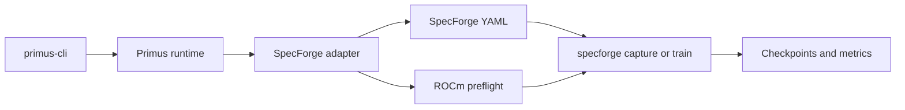
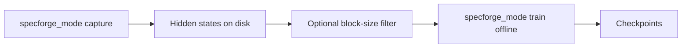
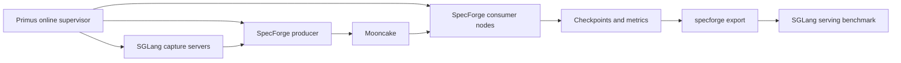

# SpecForge

SpecForge trains **speculative-decoding draft models**. A smaller draft proposes tokens; a larger target model verifies them. SpecForge owns the draft methods, Hydra YAML, data prep, training loop, checkpoints, export, and SGLang serving. Primus launches that trainer on AMD GPUs through `primus-cli` with `framework: specforge`.

This page is the overview. [Run SpecForge with Primus](running.md) has copy-paste commands. [Configuration](configuration.md) lists Primus YAML, env, and CLI keys. The [runtime image](runtime-image.md) is required: the published `primus` wheel does not include this backend.

Draft architecture, ShareGPT prep, `specforge export`, and serving stay in the
[SpecForge AMD ROCm tutorial](https://github.com/sgl-project/SpecForge/blob/main/docs/sections/basic_usage/AMD/amd_rocm.md).

## What Primus adds

SpecForge already trains drafts on a single node. Primus does not reimplement those methods or make them faster. It productizes the AMD path:

- One `framework: specforge` backend next to Megatron and TorchTitan.
- A pinned ROCm image (SGLang, SpecForge, this Primus tree).
- Homogeneous capture and offline train through `direct`, `container`, or `slurm`.
- Multi-node **online** launch that SpecForge will not start itself: one Slurm allocation, Mooncake + SGLang, then `--role producer` / `--role consumer`, with loopback Hydra URLs rewritten to routable IPs after allocate.

One-node online (Mooncake + SGLang + producer + consumer on a single host) is SpecForge `managed_local`. Run the SpecForge CLI inside the image, not `primus-cli`.

Primus stops at checkpoints and metrics. Export and serving are a later SpecForge CLI step:

## Capture, offline train, and online train

Two Primus knobs:

| Knob | Values | Meaning |
| --- | --- | --- |
| `specforge_mode` | `train` \| `capture` | Which program Primus runs (`train` if omitted) |
| `specforge_train_mode` | `online` \| `offline` | How train runs. Required when mode is `train`. Ignored for capture. |

**Capture** runs SpecForge `scripts/prepare_hidden_states.py` and writes target hidden states to disk. **Offline train** is `specforge train` on those shards. **Online train** recaptures live: Mooncake + SGLang on capture nodes, a SpecForge producer, and consumer trainers.

Offline path:

Online data flow. Primus's online supervisor starts the sidecars; SpecForge still trains. Export and the serving benchmark are the user follow-up:

The start order, `inference.ready`, and teardown are in [Run SpecForge with Primus](running.md).

## Methods and models

The Primus launcher is **model- and method-agnostic**. Train forwards `specforge_config` and `specforge_overrides` to `specforge train`. Online starts Mooncake, SGLang, `--role producer`, and `--role consumer` without a draft-method switch. Anything SpecForge supports is launched the same way.

The copy-paste recipes and published MI355X numbers use **Qwen3.5-4B DFlash**. That is a worked example, not a support boundary. Point `specforge_config` at another SpecForge Hydra YAML (EAGLE3, Domino, DSpark, other targets) and keep the same Primus launch.

Two caveats:

- If capture sets both `output_path` and `filter_output_path`, Primus runs a block-size keep filter (`filter_block_size`; the DFlash example uses 16). Omit `filter_output_path` when a method should not use that rule. Train on `filter_output_path` when the filter ran, not on the raw shards.
- The serving image must include the speculative algorithm you will serve.

## In this section

| Page | Contents |
| --- | --- |
| [Run SpecForge with Primus](running.md) | `primus-cli` modes, capture, offline train, online train, MI355X results |
| [Configuration](configuration.md) | Primus YAML, env, and CLI; SpecForge Hydra stays in SpecForge docs |
| [Runtime image](runtime-image.md) | Build and run `primus-specforge:v0.5.14-rocm700-mi35x` |
