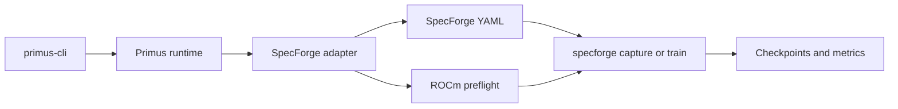
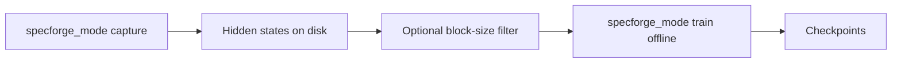
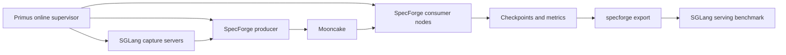

# SpecForge

[SpecForge](https://github.com/sgl-project/SpecForge) trains speculative-decoding draft models: a smaller draft proposes tokens, and a larger target model verifies them. SpecForge owns the draft methods, Hydra YAML, data prep, training loop, checkpoints, export, and SGLang serving.

AMD GPUs are already a supported SpecForge platform. The [SpecForge AMD ROCm tutorial](https://github.com/sgl-project/SpecForge/blob/main/docs/sections/basic_usage/AMD/amd_rocm.md) covers environment setup. For multi-node online training it still leaves the operator to start SGLang, Mooncake, and the trainer on each node — in the right order, with routable IPs, and with health checks between them.

With this Primus integration, you launch SpecForge training on AMD GPUs through a single `primus-cli` command and a validated Docker image.

## The Integration

Primus productizes draft-model training on AMD GPUs: a faster, more reproducible setup, less operational work for the user, and a path that scales from a smoke run to a cluster job.

- One `framework: specforge` backend.
- A validated ROCm image with SGLang, SpecForge, and Primus installed.
- A unified `primus-cli` entrypoint for offline and online training, on one node or many.
- Orchestration of Mooncake, SGLang capture, the producer, and consumers for disaggregated online training.

## High Level Architecture

Offline path:

Online path:

More details in [Run SpecForge with Primus](running.md).

## Methods and models

The Primus launcher is **model- and method-agnostic**. Any drafter and target architecture SpecForge supports is launched the same way through Primus.

## In this section

| Page | Contents |
| --- | --- |
| [Run SpecForge with Primus](running.md) | Launch with `primus-cli`, capture, offline train, online train, example and reference MI355X results |
| [Configuration](configuration.md) | Primus YAML, env, and CLI |
| [Runtime image](runtime-image.md) | Build and run the `primus-specforge` image |
